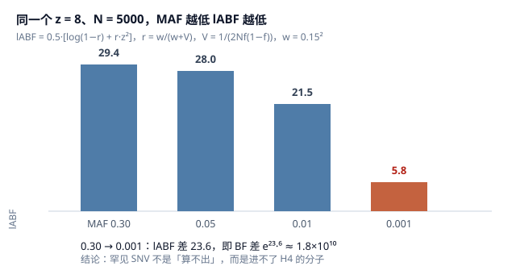
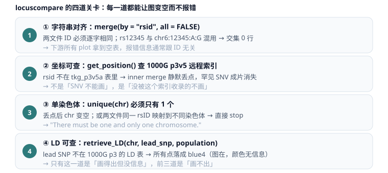

# 为什么 coloc 能算 SNV，而 locuscompare 画不出带 rsID 的 SNV

讨论的主题是「术语层 / 模型层 / 索引层」之间的错配。

作者：苗圣笛（Miao Shengdi）· <miaoshengdi@hunnu.edu.cn>

> **English abstract**
> `coloc` and `locuscompare` are both described as "SNP-level" tools, which produces a puzzle: `coloc` computes happily on a rare SNV, while `locuscompare` refuses to plot an SNV that *does* carry an rsID.
> The resolution is that these two facts live on different layers. `coloc`'s input contract contains only `z` and `V`; there is no variant-class field that could fail. `locuscompare` joins two tables on the **literal rsid string**, then resolves coordinates through a **remote MySQL index of 1000 Genomes phase 3 v5**; anything outside that index is dropped by an inner join, and an empty chromosome vector triggers `stop()`.
> Biological fact: SNP ⊂ SNV. Database fact: rsID is a *registration number*, not a class label. Tool fact: the plotting failure is a **key / index mismatch**, not a type restriction.

---

## 0. 本文的范围

本文以**概念辨析与源码层面的定位**为主。第 7 节放的是我自己跑过的一个实例，代码在 `scripts/` 里，可以对着它看上面四道关卡是怎么落空的。

结论里涉及的每个数字都标注了来源：或来自公开公式（可自行代入复算），或来自源码原文引述，或标注为模拟示例并给出参数。

---

## 1. 一句话结论

1. **术语**：SNP 是 SNV 的子集。rsID 不专属 SNP，dbSNP 是"全部短变异"的存档，罕见变异、体细胞变异照样发号。所以"SNV 有 rsID"完全正常，"有 rsID 却不是 SNP"也不矛盾。
2. **模型**：`coloc` 只吃 `z` 和 `V`，输入契约里没有"位点类别"。因此它对 SNV 照样成立。罕见 SNV 的 `lABF` 掉 20 以上，进不了 H4 的分子。
3. **工具**：`locuscompare` 的失败与变异类型无关。这四道关卡每一道都失败得**很安静**，从 rsid 字符串对不齐一直到 LD 查不到，报错信息里一个 "SNV" 字样都没有。

---

## 2. 四个层面的辨析

同一个位点，在四个层面有四个不同的"能指"。混淆层与层，就会得出"SNV 不该有 rsID""工具歧视 SNV"这类错误推论。

| 层面 | SNV | SNP | 关系 |
|---|---|---|---|
| ① 序列事件层 | 单碱基替换事件（A>G、C>T），**不问频率**，体细胞 / 罕见 / 常见都算 | 离开群体频率无法定义 | **SNP ⊂ SNV** |
| ② 群体遗传层 | SNV 中频率不足的那批 | SNV 中"够常见"的一支：germline + MAF ≥ 1%（至少一个主群体、≥ 2 个无亲缘个体携带） | SNP 是 SNV 的**子类** |
| ③ 数据库登记层 | dbSNP 是"全部短变异"的存档 | rs 号**不专属**于 SNP | rsID 是**登记号**，不是分类标签 |
| ④ 工具实现层 | `coloc` 的列名叫 `snp`，`locuscompare` 的列名叫 `rsid` | 同左 | 只是**变量名**，与生物学分类无关 |

**正面口径**：NHGRI 的表述是 "A subtype of SNVs is called a single-nucleotide polymorphism (SNP)"；HGVS 反过来规定 SNP 的首选术语就是 SNV。

**反面口径**：dbSNP 明确说自己"是全部短序列变异的存档，而不只是频率高到能称为 polymorphic 的单碱基替换"，并单独给出 common 的判定门槛（MAF ≥ 0.01、germline、≥ 2 个无亲缘个体）。

**辩证的落点**：① 层说 SNP ⊂ SNV，② 层里 SNP 与 SNV 又像"按频率切开的两支"，两句都对，因为 "SNV" 在 HGVS 体系里是上位词，而在日常检索语境里常被当作"非 common 的那一支"。

由此得到本文的核心判据。

> **rsID 只证明"dbSNP 收了它"。它既不证明这是 common SNP，也不证明 1000G 索引里有它。**

---

## 3. coloc 为什么以位点为计算单元

### 3.1 输入契约里没有"类别"

一个 `dataset` 就是**一个区域**，每一行是区域内一个位点。库里没有"基因"这个对象。所谓"对某基因做共定位"，指的是"取该基因 ±N kb 的区间"。

输入只需两类信息：位点的`z`（或 `beta` + `varbeta`），以及它的`V`。键（`snp` 列）的作用只是把两张表对齐，**填什么字符串都可以**。`chr6:12345:A:G` 与 `rs12345` 在模型眼里完全等价。

### 3.2 三步计算（对应 `R/claudia.R`）

**① 每个位点一个 Bayes 因子**（`approx.bf.estimates`）

$$z_i=\frac{\beta_i}{\sqrt{\mathrm{varbeta}_i}},\quad V_i=\mathrm{varbeta}_i=\frac{1}{2Nf(1-f)},\quad w=\begin{cases}0.15^2 & \text{quant}\\0.2^2 & \text{cc}\end{cases}$$

$$r_i=\frac{w}{w+V_i},\qquad \mathrm{lABF}_i=\tfrac12\left[\log(1-r_i)+r_i z_i^2\right]$$

这个式子可以用官方 vignette 公布的一行输出验算：`V = 0.006158578, z = 3.105184` → `lABF = 3.0866`，与该页打印的 `3.08656163` 一致。

公式里只有 $z^2$，所以 **beta 方向、回文 SNP 判错方向都不改变 `coloc.abf` 的 PP**；这也是它"只给 p 值也能算"的原因。

**② 配对求和**（`combine.abf`）

$$\mathrm{H4}\propto p_{12}\sum_i A_{1i}A_{2i}\qquad \mathrm{H3}\propto p_1p_2\left[\left(\sum_i A_{1i}\right)\left(\sum_j A_{2j}\right)-\sum_i A_{1i}A_{2i}\right]$$

$H_4$ 是"两边都关联，且是**同一个**位点"，对角项求和；$H_3$ 是"两边都关联但**不是同一个**"，全组合减对角项。再与 $H_0,H_1,H_2$ 一起归一化，得到 PP.H0–PP.H4。

**③ 条件在 H4 上的逐位点后验**

$$\mathrm{SNP.PP.H4}_i=\frac{A_{1i}A_{2i}}{\sum_j A_{1j}A_{2j}}$$

### 3.3 一个必须记住的陷阱

`SNP.PP.H4` **恒求和为 1**，与 H4 成不成立无关；它只是"假设 H4 为真时，是哪个位点"。

在一组参数明确的模拟示例中（300 位点、`N=5000`、`MAF=0.30`、两性状峰位错开）：

| 指标 | 数值 |
|---|---|
| PP.H3 | ≈ 1.00 |
| PP.H4 | 2.2e-9 |
| 榜首 `SNP.PP.H4` | 0.800 |
| Σ `SNP.PP.H4` | 1.000 |

H4 基本为零，条件分布却照样给出一个"看起来很像 lead"的位点。**不看 PP.H4 就去读 `SNP.PP.H4`，等于拿一个不成立的条件分布挑位点。**（该表为模拟示例，参数如上，可自行复算。）

### 3.4 罕见 SNV 在 ABF 里到底掉多少

固定 `z = 8`、`N = 5000`、`w = 0.15²`，只改 MAF，代入 3.2 节公式：

| MAF | V | r | lABF |
|---|---|---|---|
| 0.30（典型 SNP） | 4.76e-4 | 0.979 | **29.4** |
| 0.05 | 2.11e-3 | 0.914 | 28.0 |
| 0.01（SNP 门槛） | 1.01e-2 | 0.690 | 21.5 |
| 0.001（典型罕见 SNV） | 0.100 | 0.184 | **5.8** |



MAF 从 0.30 降到 0.001，lABF 差 23.6，即 BF 差 **1.8×10¹⁰**。放进 $\sum_i A_{1i}A_{2i}$ 里，这个位点几乎不可能成为分子。

### 3.5 "能算"要分三层说

- **能不能算**：能。`coloc` 不看类别，只要有 `V`。
- **算得准不准**：罕见变异单点 `z` 的正态近似不成立（应做 burden / SKAT），且 `V` 在低频端由 MAF 反推，误差被 $f(1-f)$ 放大。
- **该不该用**：体细胞 / 临床变异没有群体频率，先验框架失义。这类数据**不该算**。

把这三层压成一句"coloc 能算 SNV 吗"，就会得到一个既对又误导的答案。

---

## 4. locuscompare 为什么"只画得动 SNP"

### 4.1 源码执行链

主函数 `locuscompare()` 的顺序（`R/locuscompare.R`）：

```
read_metal()  →  merge(d1, d2, by = "rsid", all = FALSE)
              →  get_position(merged, genome)          # 远程 MySQL
              →  chr = unique(merged$chr); if (length(chr) != 1) stop(...)
              →  retrieve_LD(chr, snp, population)     # 远程 MySQL
```

`get_position()` 的实现原文：

```r
cmd = sprintf("select rsid, chr, pos from tkg_p3v5a_%s where rsid in ('%s')",
              genome, paste0(x$rsid, collapse = "','"))
res = DBI::dbGetQuery(conn = conn, statement = cmd)
y   = merge(x, res, by = 'rsid')      # 内连接：查不到的行直接消失
```

`retrieve_LD()` 查的是 `tkg_p3v5a_ld_chr%s_%s`，即 1000 Genomes Phase 3 v5 的 LD 分表。

### 4.2 四道关卡



| # | 关卡 | 源码行为 | 失败模式 |
|---|---|---|---|
| ① | rsid 字符串对齐 | `merge(..., by = "rsid", all = FALSE)` | 交集 0 行 → 下游拿到空表；报错信息与 ID 无关 |
| ② | 坐标可查 | `get_position()` → inner merge | 静默丢行；罕见 SNV 成片消失 |
| ③ | 单染色体 | `if (length(chr) != 1) stop(...)` | `"There must be one and only one chromosome."` |
| ④ | LD 可查 | `retrieve_LD()` | 图能出，但所有点落成 `blue4`，颜色无信息 |

### 4.3 为什么它失败得那么安静

- ①②③ 都是**内连接**：查不到就删行，不警告、不计数。
- 行删光之后，失败点从"数据问题"漂移成"坐标问题"，最后暴露成 `stop()` 的那句染色体提示，与 ID 和变异类型全无关系。
- 于是最自然的误读是"这个工具只支持 SNP"。

真实原因几乎总是二者之一：**rsID 不在 `tkg_p3v5a_hg19|hg38` 这张坐标表里**；或**两张表的 ID 写法不一致**（一边 `rs12345`，一边 `chr6:12345:A:G`）。

### 4.4 一个版本细节

`v1.1.0` 新增 `ld=` 参数，可自带 LD 表绕过 `retrieve_LD()`；但它**不绕过 `get_position()`**，源码中 `ld` 非空时仍执行 `get_position(merged, genome)`。所以"我传了 ld 还是报错"是正常现象，不是用法错误。

---

## 5. 这个误解为什么能长期存在

这是术语史留下的坑，值得单独记一笔。

1. **SNP 一词诞生于 HapMap 时代**，那时"在人群中出现频率 ≥ 1%（早期甚至 5%）"是硬门槛，"polymorphism"本身就意味着"多态"。GWAS 用的正是这一批。
2. **高通量测序改变了几何**：现在每个样本都能报出成千上万个频率远低于 1% 的位点，它们**不是** polymorphism，但是同一类序列事件。HGVS 因此改推 "SNV"，把 SNP 降为 SNV 的一个子类；dbSNP 也从"SNP 库"扩成"短变异库"，对罕见变异照样发 rs 号。
3. **工具生态没跟上**：从包名到函数参数都还沿用 SNP 的说法，`coloc.abf()` 的列叫 `snp`，`locuscompare()` 的参数叫 `rsid`，`retrieve_LD()` 的列叫 `SNP_A` / `SNP_B`。这些残留叫法描述的是**当年**的数据形态，不是今天的输入。
4. **结果**：用户看到"列名叫 snp、工具说 SNP"，就以为工具在做类型判定；于是在失败时报出"SNV 不支持"这种归因，真正的原因（key 与索引）被掩埋。

**遇到 `not supported` 或空图，先查 key，再查索引，最后才怀疑生物学分类。**

---

## 6. 边界与反例

辨证不能只往一个方向推，这里有三个反向的提醒。

- **不是所有 SNV 都能进 `coloc`**。最常见的是体细胞突变与临床变异（COSMIC、ClinVar 一类）：既没有群体 MAF，也没有可用的 `N`，`V` 无从估计，单点 `z` 模型也不成立。这类数据应走 burden / SKAT，或只做描述性比较。
- **LocusCompare 只做可视化，不构成共定位证据**。它画的是"两列 −log10(p) 的镜像轨道 + 中间散点"，图能出来不等于共定位成立；反过来，图画不出来也不等于没有共定位。
- **PP.H4 高不等于因果**。它成立于单因果变异、位点间独立（不建模 LD）以及两数据集同源人群这些假设之上；多信号场景应换 `coloc.susie`，并按 signal 对解释结果。

---

## 7. 一个实案：C3AR1 × SLE

`drugGene13.coloc.R` 跑的是这组数据：eQTL 侧 `eqtl-a-ENSG00000171860`（C3AR1），结局是 FinnGen R12 的 `M13_SYSTSLCE`。两边都给 rsID，位点落在 chr12 约 7.98–8.07 Mb，lead 是 rs2072448。

`locuscompare()` 在这个区域出不了图。这批位点不在 `tkg_p3v5a` 的两张远程表里，`get_position()` 的内连接把行删空，`unique(merged$chr)` 拿到空向量，最后停在 `stop("There must be one and only one chromosome.")`。rsID 齐备改变不了这个结果：rsID 只说明 dbSNP 收过它，不说明 1000G p3v5 的索引里有它。

绕开的办法是坐标和 LD 都不向 1000G 要。

- 坐标。eQTL 侧取 VCF 的 `chr` 与 `pos`，GWAS 侧取 FinnGen 汇总统计的 `#chrom` 与 `pos`，两边按 `SNP` 字符串取交集。共定位区是 lead 位点 ±50 kb，lead 由基因 ±100 kb 窗口内 P 最小的位点决定。
- 统计量。两侧各自算 `varbeta = se²` 和 `z = beta/se`，`coloc.abf()` 的 `type` 分别是 `quant` 和 `cc`，GWAS 侧再给 `s = ncase / (ncase + ncontrol)`。
- LD 与作图。本地 plink 算出的 LD 矩阵按位置最近邻匹配，容差 200 bp，交给 `geni.plots::fig_region_stack()`。图上两条 −log10(p) 轨道同轴对齐，右侧是重组率，lead 位点带标签。

[图：C3AR1 × SLE 区域堆叠](docs/figures/C3AR1-SLE-region-stack.pdf)

`r2` 大量落在 0.0–0.2，白圈是 LD 面板里查不到、只能标 miss 的位点。这批 miss 点说明的是同一件事：能不能画取决于手上有没有这些位点的 LD，与它们叫 SNP 还是 SNV 无关。

三处细节需要核对，写在这里而不是留在代码注释里。

- 脚本调用 `fig_region_stack()` 时传了 `build = 38`，`ld_pos.rds` 的注释写的却是 GRCh37 位置。两套坐标如果真跨 build，200 bp 的最近邻匹配会大面积落空，`corr` 退回 `NULL`，图上 r² 只剩 miss 和低档。图里 miss 点偏多，先确认 `ld_pos.rds` 是哪个 build。
- QTL 侧的 `MAF` 直接取了 `eaf`，没有像 GWAS 侧那样折成 `min(eaf, 1-eaf)`。两侧都给了 `varbeta`，coloc 不会退回用 MAF 推 `V`，影响有限，口径不统一。
- `PPH4filter = 0.75` 只用于筛结果表，不改 `coloc.abf` 的 PP 本身；`SNP.PP.H4` 的读法仍受第 3.3 节约束。

---

## 8. 已补充

- [x] `scripts/`：见 [`scripts/drugGene13.coloc.R`](scripts/drugGene13.coloc.R)，第 7 节的案例就是它跑出来的。


欢迎 issue 讨论；如果你也遇到过"有 rsID 但画不出来"，请在 issue 里贴三样东西：两张表的 ID 写法、`length(intersect(id1, id2))`，以及 `unique(chr)` 的取值。这三条基本能定位到具体是哪一关。

---

## 9. 参考文献与源码位置

- Giambartolomei C. et al. *Bayesian test for colocalisation between pairs of genetic association studies using summary statistics.* PLoS Genet 2013. `doi:10.1371/journal.pgen.1004383`
- Wallace C. *A more accurate method for colocalisation analysis allowing for multiple causal variants.* PLoS Genet 2021.
- coloc 文档与源码：<https://chr1swallace.github.io/coloc/> · <https://github.com/chr1swallace/coloc>
- LocusCompareR：<https://github.com/boxiangliu/locuscomparer>（Liu B. et al. *Nature Genetics* 2019, `doi:10.1038/s41588-019-0404-0`）
- NHGRI 术语：<https://www.genome.gov/about-genomics/educational-resources/fact-sheets/human-genomic-variation>
- HGVS 术语表：<https://hgvs-nomenclature.org/stable/background/glossary/>
- dbSNP 范围与 common 判定：<https://www.ncbi.nlm.nih.gov/books/NBK174586/> · <https://www.ncbi.nlm.nih.gov/variation/docs/snp2_human_variation_vcf/>

## License

MIT，见 [LICENSE](LICENSE)。
